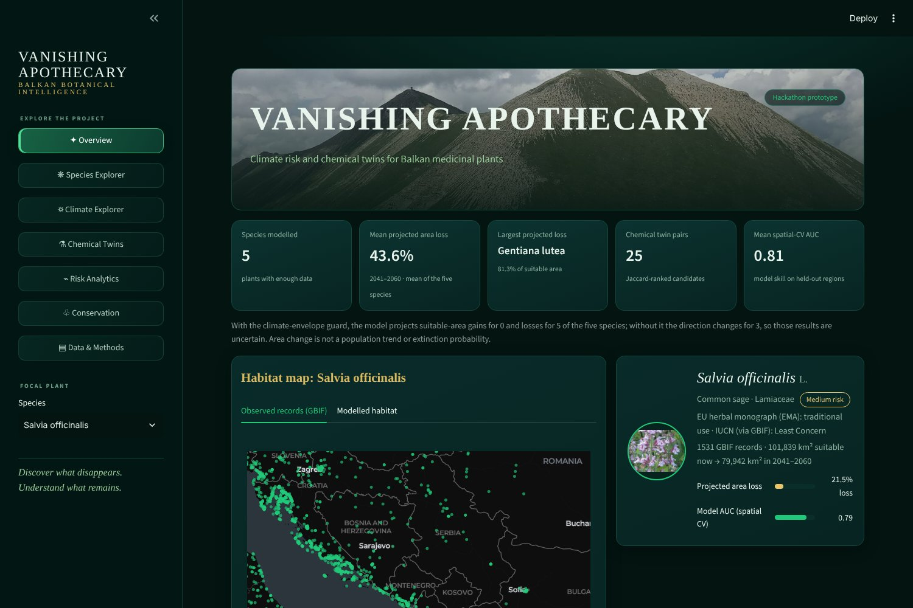
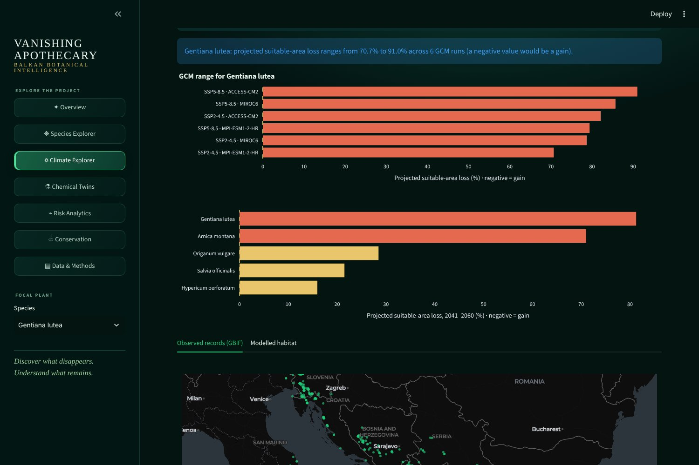
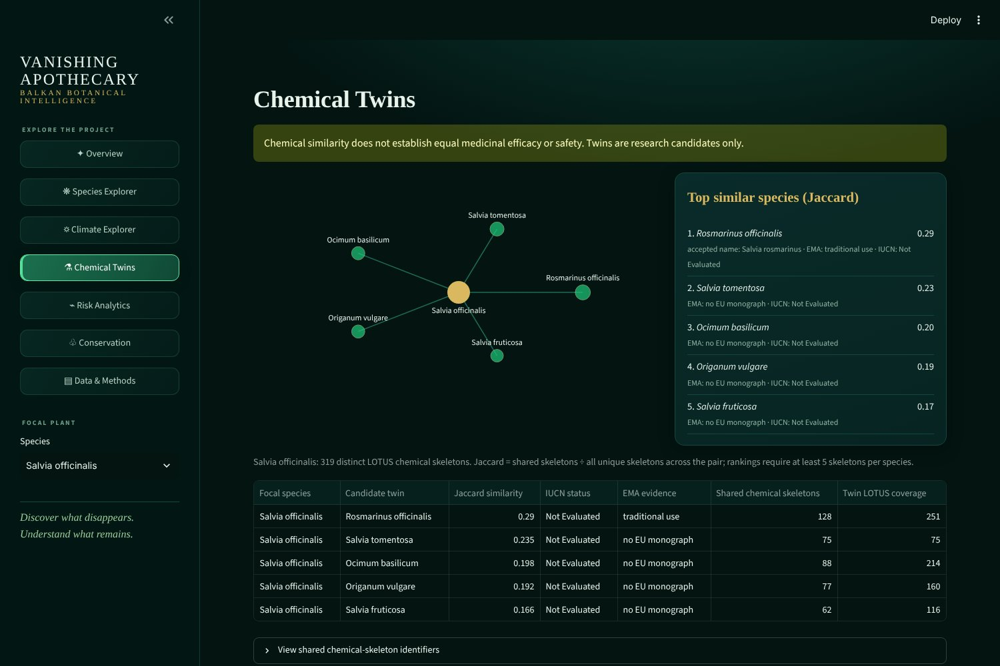
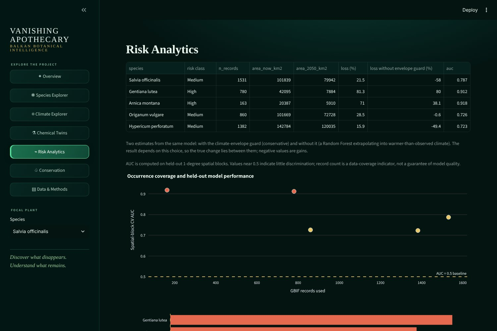

# Vanishing Apothecary: Climate Risk & Chemical Twins for Balkan Medicinal Plants

**Team TheSilentFixers** · EthnoHack 2026 · **Track 3: Biodiversity & Sustainability** (linked to Track 2: Natural Products)

> Where could the suitable climate of Balkan medicinal plants change by 2041–2060, and which chemically similar plants might be candidates to take pressure off wild harvesting?

| | |
|---|---|
| Devpost | https://devpost.com/software/vanishing-apothecary-climate-risk-chemical-twins |
| Pitch video | [Watch on YouTube](https://youtu.be/jHiG3CBmrUU) |
| Slides | [add the link after upload] |
| Live dashboard | [vanishing-apothecary.streamlit.app](https://vanishing-apothecary.streamlit.app/) ||

---

## 1. Challenge and problem

Wild medicinal plants of the Western Balkans are collected for local use and wider trade, and there are reports of unsustainable harvesting for some species. At the same time, climate change may shift or shrink the areas where these plants can grow. We did not find a regional, species-level assessment for the Western Balkans that combines **future climate suitability** with **chemically similar species** and an **evidence check against EU herbal monographs**.

**Our question:** for five widely used medicinal plants, how does modelled suitable area change by 2041–2060, and which same-family plants share the most recorded natural-product skeletons with them?

**What this project is not:** it does not measure harvest pressure, population size or extinction risk, and it does not claim that any plant can replace another medicinally. "Chemical twins" are research candidates only.

## 2. Key results

### Climate suitability, 2041–2060 (mean of 6 GCM/scenario runs)

| Species | GBIF records | Suitable now (km²) | 2041–2060, with guard (km²) | Loss with guard (%) | Range across runs (%) | Loss without guard (%) | Spatial-CV AUC | Raw suitable area removed by guard (%) |
|---|---|---|---|---|---|---|---|---|
| *Gentiana lutea* L. | 780 | 42,095 | 7,884 | **81.3** | 70.7–91.0 | 80.0 | 0.912 | 10.0 |
| *Arnica montana* L. | 163 | 20,387 | 5,910 | **71.0** | 57.6–82.5 | 38.1 | 0.918 | 65.2 |
| *Origanum vulgare* L. | 860 | 101,669 | 72,728 | 28.5 | 14.1–36.5 | -0.6 | 0.726 | 30.2 |
| *Salvia officinalis* L. | 1,531 | 101,839 | 79,942 | 21.5 | 5.7–41.2 | -58.0 | 0.787 | 51.1 |
| *Hypericum perforatum* L. | 1,382 | 142,784 | 120,035 | 15.9 | 6.9–30.3 | -49.4 | 0.723 | 44.5 |

Negative values are modelled **gains**. "With guard" counts suitable area only inside each plant's observed climate range (conservative). "Without guard" lets the Random Forest extrapolate into warmer-than-observed climate. Both come from the same model (`outputs/risk.csv`, per-run values in `outputs/risk_scenarios.csv`).

**Reading the result.** Both mountain plants lose suitable area under both estimates (*Gentiana lutea* about 80%, *Arnica montana* 38–71%), so this finding is robust. For the three widespread species the direction depends on the assumption: with the guard they lose 16–29%, without it *Origanum* is about unchanged and *Salvia* and *Hypericum* appear to gain. Those gains rely on extrapolation beyond the observed climate and should not be trusted. The result is therefore **robust for mountain plants and uncertain for widespread ones**. The guarded numbers are a conservative, pessimistic estimate, not a prediction.

### Chemical twins (top candidate per plant)

From `outputs/twins.csv`. Jaccard = shared LOTUS compound skeletons ÷ all unique skeletons across the pair. IUCN category is read from GBIF's copy of the IUCN Red List checklist and cross-checked against Wikidata (`data/iucn_status.csv`, retrieved 2026-11-06). Where the two disagree we show "sources disagree" instead of guessing.

| Focal plant | Top same-family candidate | Jaccard | EU monograph (EMA) | IUCN (via GBIF) |
|---|---|---|---|---|
| *Salvia officinalis* | *Salvia rosmarinus* (formerly *Rosmarinus officinalis*) | 0.290 | traditional use | Not Evaluated |
| *Gentiana lutea* | *Gentianella campestris* | 0.275 | none | Not Evaluated |
| *Arnica montana* | *Arnica chamissonis* | 0.114 | none | Not Evaluated |
| *Origanum vulgare* | *Thymus longicaulis* | 0.281 | none | Not Evaluated |
| *Hypericum perforatum* | *Hypericum maculatum* | 0.221 | none | Not Evaluated |

Across all 25 ranked pairs only 4 have an EU monograph. Scores are low (about 0.1–0.3). Jaccard on database records reflects how well each species has been studied, so it measures overlap in the literature as much as in chemistry. Of the 28 plants and candidates, 2 are Least Concern in both sources (*Salvia officinalis*, *Arnica montana*), 1 has conflicting categories (*Origanum dictamnus*: Least Concern in GBIF, Near Threatened in Wikidata) and 25 have no global assessment in either source. These are global categories only: regional and national assessments (for example the European Red List of Medicinal Plants or national red lists) are not included and can differ.

### Data-gap finding

*Sideritis scardica* (Greek mountain tea) was planned but **cannot be modelled**. On 2026-11-04 GBIF had 43 records in our region (23 usable after quality filters, minimum 30) and LOTUS/Wikidata only 2 compounds (minimum 5). We report it as insufficient data instead of forcing a model. It does have an EU traditional-use herbal monograph, so the gap is in occurrence and chemistry data.

## 3. Screenshots and demo

Real screenshots of the running dashboard (data as of 2026-11-06):






More: [species explorer](docs/screenshots/03_species_explorer.jpg), [overview, lower part](docs/screenshots/02_overview_lower.jpg), [data and methods](docs/screenshots/07_data_and_methods.jpg).

Demo video: [Watch on YouTube](https://youtu.be/gniCswPyGHs)

The dashboard shows a yellow **SAMPLE DATA** banner whenever it falls back to placeholder files.

## 4. Technologies

- **Language:** Python 3
- **Data and modelling:** pandas, NumPy, scikit-learn (Random Forest, spatial block cross-validation), rasterio, matplotlib, requests
- **Dashboard:** Streamlit, Plotly
- **Testing:** pytest (including dashboard tests with Streamlit's `AppTest`)
- **Data services:** GBIF API, WorldClim 2.1 / CMIP6, Wikidata SPARQL (LOTUS), EMA herbal monographs, Wikimedia Commons (photos)

## 5. Data sources and licences

| Data | Source | Licence / terms | Used for |
|---|---|---|---|
| Species occurrences | [GBIF](https://www.gbif.org) | CC0 / CC-BY, per record | Presence records, observed-records map |
| Climate (1970–2000 baseline and CMIP6 2041–2060; GCMs ACCESS-CM2, MIROC6, MPI-ESM1-2-HR; SSP2-4.5 and SSP5-8.5) | [WorldClim 2.1](https://worldclim.org) | CC-BY 4.0 | Bioclimatic predictors |
| Plant natural products | [LOTUS](https://lotus.naturalproducts.net) via Wikidata | CC0 | Chemical twins |
| EU herbal monograph status | [EMA / HMPC](https://www.ema.europa.eu), overview EMA/HMPC/228356/2012 Rev. 2 (March 2023) | Public, EMA must be cited | Evidence level (`data/ema_monographs.csv`) |
| IUCN Red List category (global) and accepted names | GBIF species API (GBIF's copy of the IUCN checklist) and Wikidata P141 | IUCN terms: non-commercial use, cite IUCN | `data/iucn_status.csv` |
| Species photos and hero image | Wikimedia Commons | CC BY-SA / public domain, credits in `app/assets/credits.json` and on the dashboard Methods page | Dashboard |
| WDPA protected areas | not integrated | non-commercial terms, cite | Planned |

Data were retrieved between 2026-11-04 and 2026-11-06. Large climate rasters are **not** in the repository (see Quick start).

## 6. Method

**Climate suitability** (`src/climate/sdm.py`)
1. GBIF records are filtered (coordinate uncertainty below 5 km, year 1970 or later, duplicates and living specimens removed) and thinned to one presence per 2.5 arc-minute cell.
2. Weakly correlated bioclimatic variables are selected (|r| < 0.8).
3. A Random Forest is trained on presences against 5,000 background cells. Skill is measured by AUC on held-out 1° spatial blocks.
4. The suitability threshold maximises TSS on those held-out blocks.
5. Suitable area is counted **only inside each species' climate envelope**, meaning cells where every variable lies within the range seen at that species' presence records. A Random Forest cannot extrapolate: without this guard it labels any warmer-than-observed cell as suitable, which produced inflated gains in an earlier version of our analysis. The share of raw suitable area removed by the guard is reported as `extrapolated_pct`, and the unguarded result as `loss_pct_unguarded`, so the result can be read as a range.
6. Projections for 2041–2060 under SSP2-4.5 and SSP5-8.5 with three GCMs. Outputs report net change, area lost, area gained and the range across runs.

**Chemical twins** (`src/chemistry/twins.py`)
1. Taxon–compound pairs are read from LOTUS via Wikidata (P703, P235) for the plant families of our species.
2. Compounds are compared by the first 14 characters of their InChIKey, so stereoisomers count as one skeleton.
3. Candidates are same-family **species** (no genus-level items) with at least 5 skeletons. Ranking uses Jaccard similarity.
4. Each candidate is annotated with its EU herbal monograph status (`data/ema_monographs.csv`, built and checked by `scripts/build_ema_table.py`) and its global IUCN category from two secondary copies, GBIF and Wikidata (`scripts/fetch_iucn.py`). Synonyms are resolved to the accepted name (for example *Rosmarinus officinalis* to *Salvia rosmarinus*). "not checked" means the category was not looked up.

**Dashboard** (`app/`): seven pages (Overview, Species Explorer, Climate Explorer, Chemical Twins, Risk Analytics, Conservation, Data & Methods). Results are read from `outputs/risk.csv`, `outputs/risk_scenarios.csv` (optional) and `outputs/twins.csv`. The app also reads `data/ema_monographs.csv`, `data/iucn_status.csv`, `data/lotus_compounds.csv`, the GBIF records (`data/occurrences.csv`, or the bundled `app/assets/occurrences.csv`) and the photos in `app/assets/`. If `risk.csv` or `twins.csv` is missing it falls back to `outputs/sample_*.csv` under a yellow SAMPLE DATA banner.

## 7. Quick start

```bash
pip install -r requirements.txt
python -m src.climate.fetch_gbif      # GBIF records -> data/occurrences.csv
python -m src.chemistry.twins         # LOTUS compounds -> data/lotus_compounds.csv, outputs/twins.csv
python scripts/fetch_iucn.py          # IUCN categories + accepted names -> data/iucn_status.csv
python -m src.chemistry.twins         # run again so twins.csv picks up the IUCN categories
python -m src.climate.sdm             # needs the climate rasters below -> outputs/risk.csv, risk_scenarios.csv, maps
python -m pytest -q                   # tests on synthetic data
streamlit run app/app.py              # dashboard
```

The repository already contains the outputs of these steps, so the dashboard runs right after `pip install` without any download. On Windows use `py -m` instead of `python -m`, for example `py -m streamlit run app/app.py`. On its first run Streamlit asks for an email address: press Enter to skip. (In a non-interactive shell, such as CI, add `--server.headless true` to the `streamlit run` command to skip the prompt.)

**Climate rasters (not in git).** Download WorldClim 2.1 bioclimatic variables at 2.5 arc-minutes for the current climate and CMIP6 2041–2060 for SSP2-4.5 and SSP5-8.5. Each file must be one multi-band GeoTIFF with the 19 variables in the order bio1 to bio19 (stack `bio_1 … bio_19` numerically, not alphabetically). Save as `data/climate/current.tif` and `data/climate/future_<scenario>_<gcm>.tif`, for example `future_ssp245_MIROC6.tif`.

**API keys:** none are needed. GBIF, Wikidata, WorldClim and EMA pages are queried without credentials, so there is nothing to configure.

## 8. Project structure

```
app/            Streamlit dashboard (app.py, theme.py, assets/ photos + credits)
src/climate/    GBIF download and species distribution model
src/chemistry/  LOTUS twins and EMA evidence
src/config.py   species, region, families, authorities
scripts/        reproducible helpers (EMA table, IUCN categories, photo download)
data/           ema_monographs.csv, iucn_status.csv, lotus_compounds.csv, occurrences.csv (climate rasters are not stored)
outputs/        risk.csv, risk_scenarios.csv, twins.csv, maps/ (sample_*.csv are placeholders)
docs/           screenshots of the dashboard
tests/          pytest suite
```

## 9. What we built and what we reused

| Built by the team during the hackathon | Pre-existing and used as-is |
|---|---|
| All code in `src/`, `app/`, `scripts/`, `tests/` | Python libraries: scikit-learn, pandas, NumPy, rasterio, matplotlib, Streamlit, Plotly, requests, pytest |
| Climate-envelope guard, variable selection, threshold logic and the with/without-guard comparison | Random Forest implementation (scikit-learn) |
| EMA monograph table, built from the EMA overview and checked against EMA herbal pages | EMA monograph content itself |
| Twin ranking, evidence and IUCN annotation, dashboard design | GBIF, WorldClim, LOTUS/Wikidata data, GBIF's copy of the IUCN checklist |
| Selection of species and the data-gap analysis | Wikimedia Commons photographs (credited) |

## 10. Limitations and responsible use

- **Suitable area is not abundance.** The model estimates where climate resembles that of past records. It does not estimate population size, harvest pressure or extinction probability.
- **Sampling bias.** GBIF records cluster near roads and cities. Thinning and spatial cross-validation reduce this but do not remove it.
- **Cultivated plants.** Planted garden records cannot be separated from wild ones because GBIF's `establishmentMeans` is empty for these species.
- **Extrapolation.** The climate-envelope guard is conservative: it can remove real range shifts into cells outside the sampled climate. For three of five species the direction of change depends on it.
- **Climate-model disagreement.** Only three GCMs are used. See the per-run ranges.
- **Chemistry.** Similarity measures overlap of recorded compounds, which depends on research effort. It does not establish equal efficacy or safety. Twins are research candidates, not substitutes.
- **EMA status** reflects the March 2023 overview and four plant families. Newer monographs may be missing. "No EU monograph" does not mean a plant has no traditional use.
- **IUCN categories** are global categories from secondary copies (GBIF, Wikidata) and can lag behind iucnredlist.org. Regional and national assessments are not included and can differ: a plant with no global assessment may still be assessed in Europe or listed nationally.
- **Not included:** field validation, protected-area overlap (WDPA) and harvest-pressure data.
- **Traditional knowledge.** We did not collect community knowledge. We use published databases and EU regulatory sources only. Any future work with local harvesters must respect provenance, attribution and consent.
- Nothing here is medical advice or a clinically validated finding.

## 11. AI usage

Generative AI coding assistants were used for code scaffolding, debugging and documentation drafts; the tools are listed in the Devpost submission. The team selected the species and methods, reviewed the code and every result, and takes responsibility for the content.

## 12. Team

| Member | Role |
|---|---|
| Albion Hoxha | Team lead, integration, deployment, submission |
| Afron Makolli | Climate and spatial modelling (GBIF pipeline, species distribution models) |
| Rinesa Sekiraça | Chemistry (LOTUS pipeline, chemical twins), dashboard polish and presentation |

## Licence

Code: MIT (see `LICENSE`). Data and photos keep the licences listed in section 5.
